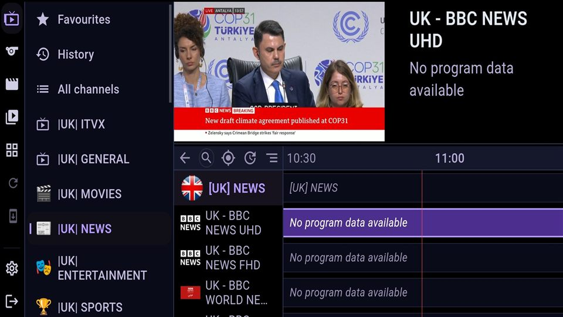
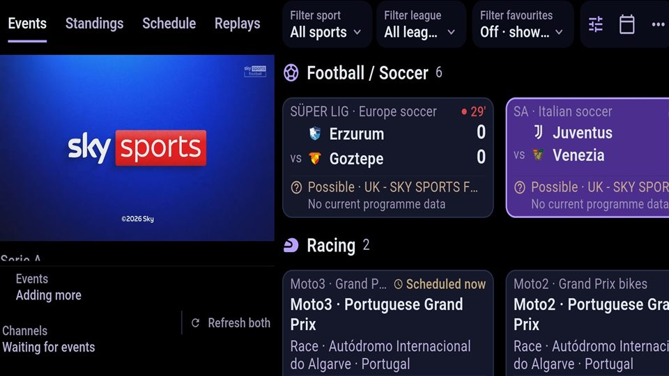

# OKTV

OKTV is a free, open-source IPTV player for Android TVs, TV boxes and Android phones. You bring your own authorised playlist — nothing else is bundled.

Website: https://oktvhq.digital

## Features

**Watching**

- Live TV with a full electronic programme guide, quick search and a resumable live view
- Movies and TV Shows libraries with artwork, categories and watch history
- Sports screen with live scores, schedules, replays and highlights
- Twin Screen — two channels side by side, each labelled with its provider and channel
- Picture-in-picture and smooth handoffs between preview and fullscreen
- Gentle live-playback recovery that fixes most stalls before reconnecting

**Recording**

- Record the current live channel for 30 minutes, an hour, or until you stop it
- Recordings show the programme name in the REC section and in the saved file
- A copy is saved in Android Downloads

**Making it yours**

- Rename channels and categories, with an emoji icon picker including home-nation flags
- PIN-lock categories so they ask for a code before opening
- Hide groups or channels, reorder categories, and choose from several themes
- Large text option and an optional fullscreen player clock

**Safe backups**

- Encrypted, passphrase-protected backups of playlists and settings
- Transfer over Wi-Fi to a phone or PC, or keep a copy in Downloads

## Screenshots

| Main UI | Sports section |
| --- | --- |
|  |  |

## Device support

**Supported:** Android TVs, TV boxes and TV sticks (including older boxes), and Android phones.

**Not supported:** Samsung Tizen, LG webOS, Apple TV and other non-Android platforms. Use an Android box or stick on those TVs.

> **Important:** recordings run while the app is open. There is no scheduled or background recording.

## Installation

### On a TV box — Downloader code

Open **Downloader** and enter code **4638245**. Install the APK when prompted.

### Directly

Download `OKTV.apk` from the [latest release](../../releases/latest), copy it to your device and open it to install.

### Google Play Protect

Play Protect may say the app is from an unknown developer, or harmful. That happens to any app not installed from the Play Store. Choose **More details / Install without scanning → Install anyway**. 100% safe.

## Updating

OKTV has a built-in updater. A few seconds after launch it checks this repository and offers the newest release. You can also check anytime in **Settings → App updates**. Only the two newest APKs are kept here, so there is always a fallback if an update misbehaves.

This repository is public so devices can fetch updates without a GitHub login. The application source stays private.

## Recent changes

- **v0.2.18** — optional merged listings for duplicate channels, with automatic feed choice and a Source menu
- **v0.2.17** — per-playlist buffering levels for steadier streams, and D-pad Right recalls the last channel
- **v0.2.16** — playlist volume levels work properly and can be set from the player menu
- **v0.2.15** — per-playlist volume levels, so louder playlists can be turned down to match
- **v0.2.14** — steadier live playback; no more brief pauses or repeated seconds on some channels
- **v0.2.13** — Forest theme, themed player panels and slimmer Twin Screen labels
- **v0.2.12** — transient 403s are retried; Referer/User-Agent support and stream diagnostics
- **v0.2.11** — guide focus stays on the channel you were editing after a hide or rename
- **v0.2.10** — programme names in recordings, more reliable backup copies
- **v0.2.9** — live TV recording, provider names in the player, star favourite shortcut
- **v0.2.8** — Twin Screen with two labelled panels and quicker startup
- **v0.2.7** — new OKTV icon and startup artwork
- **v0.2.6** — PIN-locked categories

## Attribution

Based on [VesperTV](https://github.com/NoXqc/VesperTV) by NoXqc and contributors. Independently maintained under GPL-3.0.
